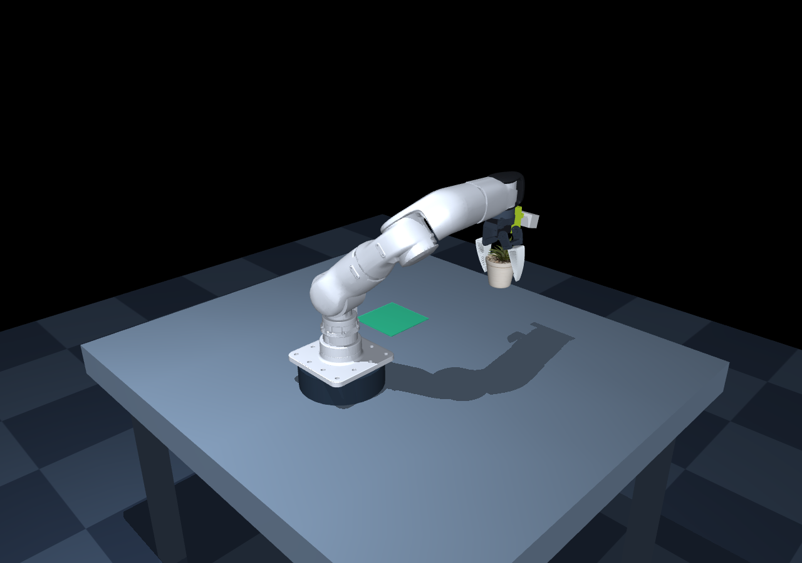

# Unitree R1-7A MuJoCo

**English** | [简体中文](README.zh-CN.md)

A standalone MuJoCo simulation of the Unitree R1-7A seven-axis arm with an XLeRobot / SO101 TPU95A Fin Ray gripper. Move and rotate the end effector with your keyboard, grasp a free potted plant through physical contact, and transfer it to a drop zone.



The scene includes the original arm meshes, joint limits and inertial properties from the Unitree SDK. The silver housing and dark end interface visually approximate the [official product photos](https://www.unitree.com/R1-ARM/); they are not an official numeric color specification. Runtime assets are included: ROS, the SDK and XLeRobot checkouts are not required to run the simulation.

Keyboard and YOLO now share the same plant scene, wrist rig, home pose, physics and motor control. See [shared control](SHARED_CONTROL.zh-CN.md). Estimated end-effector masses/COMs live in `end_effector.json` (265 g total). Both entries support `--object cube`; the keyboard launcher also supports `--no-wrist-camera`.

## Update — 2026-10-29

- Replaced the default target with the downloaded 04 plant, uniformly scaled to a **60 mm outer pot diameter** (55.4 mm pot height). Keyboard and YOLO share the scene, D435 wrist rig, home pose, end-effector load and pick/place controller.
- Added real YOLOE RGB inference and mask-based RGB-D localization: visit up to six wrist observation poses → detect → verify settling → capture fresh RGB/depth/extrinsics → fit the pot rim → grasp and place. Invalid localization advances to the next view; exhausted search stops.
- Added random target XY/yaw with `--randomize --seed 42`. The tested placement region is **X=0.10–0.18 m, Y=0.25–0.31 m**. G starts scanning; R resets and samples another pose in random mode; V only detects at the current pose.
- Unified torque-limited `q/dq/tau/kp/kd` control, 100 Hz host commands, 500 Hz motor/physics updates, configurable gravity feedforward, SDK command quantization, gradual jaw motion and optional CSV recording.
- Adjusted fixed-jaw clearance and plant insertion depth (20 mm), added tabletop-contact release and five no-slip friction-solver refinements. Grasping uses free-body contact dynamics.
- Added motor, SDK, shared-scene, search and GUI verification. Six RGB-D/contact trials with random yaw passed; localization error was 0.66–1.81 mm, with two trials requiring another observation view.

```bash
python -m pip install -r yolo_grasp/requirements.txt
./yolo_grasp/run.sh --auto --randomize --seed 42
# Without a viewer (requires EGL):
./yolo_grasp/run.sh --headless --randomize --seed 42
```

**Perception boundary:** detection uses rendered RGB and YOLOE, never simulation object IDs or object XYZ. Grasp coordinates are reconstructed from the simulated depth image and camera intrinsics. Depth is ideal MuJoCo rendering and camera-to-world pose comes from simulation. Known tabletop height, pot dimensions and pale pot color guide filtering. Object ground truth/contact IDs are used for outcome checks and contact feedback. This is not physical-D435 sensing or a measured real-world accuracy result.

The Git release includes runtime OBJ/PNG assets, code, configuration, tests, documentation and license notices. Weights, text encoders, caches, outputs, recordings, generated scenes, the replaced plant and duplicate original downloads are excluded.

## Quick start

Requires Python 3.10+ and an OpenGL desktop for the interactive viewer. Tested on Linux with Python 3.12.

```bash
git clone https://github.com/llros007/unitree_r1-7a-mujoco.git
cd unitree_r1-7a-mujoco
python3 -m venv .venv
source .venv/bin/activate
python -m pip install -r requirements.txt
./run.sh
```

Alternatively, install the requirements in an activated conda environment and run `python main.py`. Set `PYTHON=/path/to/python ./run.sh` to select an interpreter explicitly. The launch script resolves its own directory, so it can be called from another working directory.

## YOLO RGB-D grasping (optional)

See [yolo_grasp/README.md](yolo_grasp/README.md) for image-driven automatic pick/place using YOLOE and a wrist-mounted D435 RGB-D approximation, without GraspNet.

```bash
python -m pip install -r yolo_grasp/requirements.txt
./yolo_grasp/run.sh
```

Press **G** to scan, reacquire and grasp, or **V** to detect only. This extension has separate optional dependencies and leaves the original keyboard demo available.

## Controls

Click the simulation window to focus it. Hold keys for continuous motion; release them to hold the target pose. Translation and rotation use world coordinates.

| Key / mouse | Action |
| --- | --- |
| W / S | Move along +Y / −Y |
| A / D | Move along −X / +X |
| Q / E | Raise / lower along Z |
| I / K | Rotate about +X / −X |
| J / L | Rotate about +Y / −Y |
| U / O | Rotate about +Z / −Z |
| Shift + motion | Fine adjustment |
| Space | Toggle gripper open / closed |
| R | Smoothly return all seven joints to zero and hold; keep object/gripper state |
| P | Pause / resume |
| H | Print help in the terminal |
| Esc | Exit |
| Left drag | Orbit camera |
| Right drag | Pan camera |
| Scroll | Zoom |

Translation speed is 0.10 m/s, or 0.025 m/s with Shift. Rotation speed is 0.75 rad/s, or 0.25 rad/s with Shift. The overlay shows actual and target TCP positions, cube position and finger contact status. The green marker is the actual TCP; the yellow marker is the target.

## Pick and place

1. Start at the shared oblique observation pose, TCP approximately `(0.12,0.08,0.83)` m. Rotate the gripper down with I/K and move toward the pot at Y≈0.25 m.
2. Leave a few millimeters of clearance on the fixed-finger side (TCP X≈0.104 m), then descend to TCP Z≈0.635 m.
3. Press Space and wait 3–4 seconds. Jaw targets ramp at 0.30 rad/s; `contacts 2/2` means both fingers contact the pot.
4. Raise with Q. The overlay shows `OBJECT LIFTED!`.
5. Transfer over `(-0.12,0.25)` m, lower to TCP Z≈0.642 m, open, wait and retreat.

The shared miniature pot is about 60 mm wide and 55.4 mm high with an estimated mass of 80 g. Use `--object cube` to select the earlier cube scene.

The inverse kinematics controller limits targets to the reachable workspace. It does not plan collision-free paths; control the route manually and use **R** for a checked slow zero return if needed.

## Headless verification and screenshots

Run a complete physical grasp, transfer and release without opening a window:

```bash
./run.sh --headless --demo
python verify.py
```

Both commands return a nonzero exit code on failure. `verify.py` also exercises the viewer's keyboard handlers for descent, closure, lift, pause and reset, and checks for non-finite state and MuJoCo warnings. Pure headless physics verification does not create an OpenGL context. `python verify_shared.py` also checks scene/config equality and identical responses over 100 steps.

Save a rendered image at the lift phase:

```bash
./run.sh --headless --demo --snapshot grasp_preview.png
```

On a server with EGL support:

```bash
MUJOCO_GL=egl ./run.sh --headless --demo --snapshot grasp_preview.png
```

A screenshot requires a working rendering backend. For a short interactive window check, run `./run.sh --seconds 3`.

## Model and simulation details

- Fixed-base seven-axis arm, 500 Hz physics/inner motor PD and 100 Hz Cartesian position/orientation IK.
- Torque-limited arm motors with MuJoCo `gravcomp` disabled. Keyboard IK control computes explicit, configurable joint-side gravity feedforward torque from the model at the reference pose and adds it to PD before saturation. The gripper retains a force-limited position servo. Arm collisions with the table, floor and cube are enabled; arm self-collision is disabled. Arm mesh collisions use MuJoCo convex hulls.
- A fixed finger and a single servo-driven rotating jaw, using original PLA holder and TPU finger meshes extracted from XLeRobot's 3MF project. Dimensions are preserved with millimeter-to-meter conversion and rigid coordinate transforms.
- The target remains a free rigid body. Grasping uses contact friction, without welding, attachment constraints or cube teleportation.
- Gripper opening target: 0.8 rad; closing target: −0.13 rad; joint range: [−0.20, 1.05] rad. These are simulation settings, not hardware servo calibration.
- TCP: `(0, 0, 0.106)` m in the adapted gripper frame, 0.146 m from the original Link7 origin.
- Fin Ray ribs are visible, but the fingers are rigid meshes. Segmented collision proxies and soft contact (`solref=0.012 1`, friction 1.8) approximate compliance; TPU elasticity and rib bending are not simulated.

The flange adapter, mounting pose, TCP, gripper masses, inertias, friction, compliance and drive torque are simulation approximations without hardware identification. Use this project for interaction and algorithm prototyping; it does not establish real grasp force or deformation. The program does not connect to or control a physical arm.

## Joint motor control

The seven arm actuators are `motor` elements with `gear=1`. Each physics step evaluates joint-side torque:

```text
tau_target = clip(tau_ff + kp * (q_des - q) + kd * (dq_des - dq), -tau_limit, tau_limit)
```

Edit `motor_config.json` and restart, or use `./run.sh --motor-config /absolute/path/to/motors.json` with a complete alternate configuration. Arrays follow J1–J7. Defaults are `kp=60` Nm/rad from the SDK example and `kd=[6,6,4,4,2,2,1.5]` Nm·s/rad tuned in simulation. Keyboard IK updates smooth references and gravity feedforward at the 100 Hz host command rate (`command_period_s=0.01`), holding five-parameter commands between sends. The 500 Hz motor PD uses current simulated joint state. Gravity comes from an independent nominal model, including the mounted camera when present. Torque caps of `[60,60,33,33,33,10,10]` Nm come from URDF effort. The viewer displays tracking error, feedforward and applied motor torque.

`gravity_feedforward_scale=1.0` enables explicit gravity feedforward; set 0 for PD-only control. Direct commands receive no extra automatic gravity term. Combined PD/feedforward torque is capped. Very small nominal-model hold error is not a prediction of real hardware accuracy.

`sdk_protocol_calibration="assets/joint_calib.txt"` enables the local SDK's URDF/motor coordinate conversion and integer command round trip. Its path is relative to the motor JSON file. Set null or omit to disable. The calibration is an SDK snapshot, not a new measurement of this arm. Command quantization is distinct from physical encoder resolution. `verify_sim2real.py` compares 224 joint commands against the actual C++ SDK packet builder when sibling sources and g++ are available, and checks host command hold, independent gravity models and recording.

`./run.sh --record outputs/keyboard_trace.csv` records host/encoded commands, q/dq, requested/applied torque and TCP state. The companion `.metadata.json` saves model/calibration hashes, parameters and estimated end-effector masses. Output files must be new. These are simulation traces, not measured hardware data.

`motor_config.sdk.json` uses the earlier low-level hold example gains (`kp=60`, `kd=0.5`) and 50 Hz host rate with reference filtering/gravity feedforward disabled and SDK quantization enabled. Those low damping gains cause visible stop oscillation in this model. `verify.py` checks 12 translation/rotation directions, keyboard grasping and transfer with the wrist camera mounted.

`cartesian_reference_time_constant_s=0.0625` enables an exact critically damped second-order reference filter at the host command rate. Set zero to disable. IK is solved only when the requested pose changes. Direct commands bypass this reference filter and are submitted immediately on each API call, then held; the caller controls their send frequency. Enabled SDK command quantization still applies.

Passive `damping=0.1` Nm·s/rad, `frictionloss=0` Nm and joint-side `armature=0.015` kg·m² are uncalibrated estimates, distinct from controller damping. `torque_time_constant_s=0` gives instantaneous torque response; a positive measured value enables an exact first-order filter on the limited torque target.

For direct commands from Python in this directory:

```python
from environment import ArmEnvironment
from wrist_scene import build_scene

env = ArmEnvironment(scene_path=build_scene())
env.set_joint_command(q=env.home_q, dq=0, tau=0)  # Use configured kp/kd.
for _ in range(1000):
    env.step(0.002)
env.set_joint_command(q=env.home_q, kp=0, kd=0, tau=0)  # Zero torque: gravity acts.
env.step(0.01)
env.use_cartesian_control()  # Resume IK from the current pose; reset() also resumes IK.
```

`q` takes seven values; other parameters accept a scalar or seven values. Units are rad, rad/s and Nm in URDF joint coordinates at the joint output. `tau` means feedforward torque. Direct commands persist until replaced or reset and are never overwritten by IK. `verify.py` checks the five-parameter law, torque limits, free motion under gravity, static tracking error and optional motor lag in addition to the grasp/keyboard regression.

These defaults combine SDK example stiffness with simulation-tuned damping, not measured hardware calibration. End-effector masses/COM/inertias remain estimates. Current-loop dynamics, bus latency, noise, backlash, thermal limits and torque-speed curves are not modeled. There are currently no hardware traces to quantify the simulation-to-hardware error. The preview shows the shared plant scene and teleoperation motor configuration.

## Project files

| File | Purpose |
| --- | --- |
| `main.py` | GLFW viewer, keyboard/mouse controls, overlay and snapshots |
| `environment.py` | Shared dynamics, Cartesian IK, nominal gravity model and demo |
| `wrist_scene.py`, `motion.py` | Shared plant/wrist scene and pick/place controller |
| `motor_control.py`, `motor_config.json` | Joint-side PD/feedforward torque, saturation, optional motor lag and parameters |
| `build_scene.py` | Optional scene regeneration from the Unitree SDK URDF |
| `xle_gripper.py` | SO101 rotary gripper, TCP and contact parameters |
| `prepare_gripper.py` | Optional mesh extraction from the XLeRobot 3MF project |
| `verify.py` | Headless keyboard and physical transfer regression checks |
| `assets/scene.xml` | Base arm/cube MJCF; the shared builder adds the selected target and rig |
| `assets/meshes/` | Original arm meshes copied from the SDK |
| `assets/gripper/` | Transformed gripper meshes, license and provenance |
| `grasp_preview.png` | Screenshot of a physical plant lift |

## Optional asset regeneration

All assets required for normal use are already included.

To rebuild the arm scene, clone the [Unitree SDK](https://github.com/unitreerobotics/r1-7a_sdk) beside this repository as `../r1-7a_sdk`, then run:

```bash
python build_scene.py
```

The included arm meshes originate from SDK commit `2c89fe4f60f0c98f1bc06795cb2477cc73d0c92c`.

To re-extract the gripper, check out the XLeRobot revision recorded in [assets/gripper/SOURCE.md](assets/gripper/SOURCE.md), then run:

```bash
python prepare_gripper.py --source /path/to/XLeRobot
```

The extraction uses objects 47 (fixed holder), 39 (moving holder) and 49 (TPU finger) from `hardware/XLeRobot_0_3_0.3mf`. The provenance file records the source commit, source hash and transformations.

## License and acknowledgments

The standalone simulator core is licensed under [BSD-3-Clause](LICENSE). The optional Ultralytics integration and combined YOLO application are distributed under [AGPL-3.0-or-later](yolo_grasp/LICENSE). Downloaded weights retain their upstream terms; they are not bundled. See [third-party licensing](THIRD_PARTY_LICENSES.md). Unitree arm assets retain their original [BSD-3-Clause license](assets/SDK_LICENSE). XLeRobot gripper assets retain their [Apache-2.0 license](assets/gripper/LICENSE), with source and modification details in [SOURCE.md](assets/gripper/SOURCE.md).

This is a community simulation project. Thanks to [Unitree Robotics](https://github.com/unitreerobotics/r1-7a_sdk), [XLeRobot](https://github.com/Vector-Wangel/XLeRobot) and [MuJoCo](https://mujoco.readthedocs.io/).

## Radial flange mounting and startup

The gripper attaches to Link7's radial end plate, matching the supplied CAD reference, rather than along the J7 shaft. The SDK mesh plate is near local Y=-47.736 mm. The simulated hand origin is `(0,-0.061,0)` m with tool +Z=-Link7 Y, +X=-Link7 Z and +Y=Link7 X. Adapter dimensions are simulation approximations, not fabrication drawings. TCP, local inertias and camera follow the complete hand transform. J7 axes and calibration data are unchanged. The shared builder upgrades cached scene.xml mounting transforms.

Keyboard/YOLO CLIs default to `--initial-pose zero`: all seven joints are zero on startup; keyboard R smoothly returns to zero, while YOLO R still resets its task scene, now clear of tool/arm interference throughout the jaw sweep. `clearance` selects J4=45 degrees; `observation` selects the workspace observation target. G/`--auto` unfolds along a checked joint path before scanning, using an elbow waypoint when necessary to avoid sweeping the base. V/`--detect-only` uses the current camera pose; select `observation` to view the workspace.

Tool/arm explicit contact pairs exempt only the fixed Link7 mounting interface; previous adapter/Link5–6 exceptions are removed. Startup requires 1 mm clearance; Cartesian commands and unfolding paths use sampled checks. Convex mesh hulls can conservatively reject poses. This is not full-arm continuous collision planning or physical mounting certification. `python verify_tool_clearance.py` verifies flange axes, legacy mounting interference, zero jaw sweep/hold/reset and unfolding, with/without the camera.

## Select calibration at startup

```bash
PYTHON=python ./run.sh --calibration r1-7a_sdk/config/joint_calib.txt
PYTHON=python ./run.sh --calibration ../r1-7a_sdk/config/joint_calib.txt
PYTHON=python ./yolo_grasp/run.sh --calibration /absolute/path/joint_calib.txt --auto
```

`--calib` aliases `--calibration`. The CLI override takes precedence over the motor JSON calibration field. CLI relative paths use the current working directory and support `~`; JSON defaults retain their config-relative meaning. Startup prints the resolved calibration path. Missing/invalid files fail without fallback. No files are overwritten. Recorder metadata includes the selected file's actual path, contents and checksum.

## Keyboard joint-angle control

```bash
PYTHON=python ./run.sh --control-mode joint
PYTHON=python ./run.sh --control-mode joint --joint-speed 10 --calibration r1-7a_sdk/config/joint_calib.txt
```

Press **Tab** to switch between IK/Cartesian and joint-angle modes without restarting; `--control-mode` only selects the startup mode. Switching rebases targets on the measured joints/TCP, clears held keys and preserves pause state. The window title and overlay show the mode. YOLO supports the same shortcut while idle; switching is blocked during an automatic task. 1–7 selects J1–J7; hold UP/+ to increase, DOWN/- to decrease (keypad +/- supported). Release holds the target; Shift scales the default 20 deg/s rate by 0.25. Space/R/P and mouse controls remain available. The overlay shows measured/target/limit angles in calibrated URDF degrees, with a star on the selected joint. Joint limits, tool/arm swept clearance checks and the existing filtered PD/gravity controller remain active; command lead is bounded to 5 degrees. The default `--control-mode cartesian` retains endpoint controls. Check with `python verify_joint_keyboard.py`.

## Real-arm keyboard and simulation-only mode

`real_keyboard.py` shares the simulator's keyboard controller. Serial hardware is
opened **only with `--hardware`**. The bridge and calibration default to this
repository's `r1-7a_sdk/`; sibling SDK files never override configuration paths.
Use `--calib` / `--calibration` to select a different file explicitly.

```bash
# Simulation only, even when a serial device exists
python real_keyboard.py --mode sim --control-mode joint

# Hardware, showing measured joints (adjust the serial port)
python real_keyboard.py --mode sync --hardware --port /dev/ttyUSB3 \
  --calib r1-7a_sdk/config/joint_calib.txt --joint-speed 5

# Hardware, showing the simulated plant while sending its reference commands
python real_keyboard.py --mode sim --hardware --port /dev/ttyUSB3 \
  --calib r1-7a_sdk/config/joint_calib.txt --joint-speed 5
```

Both hardware modes hold the measured pose and require 20 consecutive FOC samples
before motion. Tab switches IK/joint control; 1–7 selects a joint; Up/Down jogs;
Shift slows motion. R follows a checked cosine trajectory to all-zero joints, starting from measured
joints whenever hardware is connected. Default peak speed is 5 deg/s and maximum
acceleration 10 deg/s² (`--home-speed-deg`, `--home-accel-deg`, also supported by
`./run.sh`). It checks model joint limits and tool/arm paths, trying a J4=45-degree
waypoint if needed. This is not full environment collision planning. Arrival
requires measured errors within 1 degree and low velocity for 20 cycles. If the
arm has not arrived 5 seconds after the trajectory ends, it reports this and
continues holding the target. Tab or P cancels a return; resuming does not replay
it. R does not start while paused. P freezes the reference with zero target velocity and
cancels pending motion. Space does not drive the hardware gripper.

A separate control worker owns its model and bus; rendering uses copied snapshots.
Bus response timeout defaults to 0.1 seconds (`--feedback-timeout`). FOC exit,
faults, tracking error above 0.4 rad, or an excessive estimated total torque stop
the bus. Missed periods are not replayed as command bursts. With hardware attached, an unresponsive input
window pauses motion after 0.5 seconds. Pure simulation does not auto-pause on
render delays. Click the MuJoCo window before pressing keys; in joint mode, press
4 then Up to jog J4. This is not a hard real-time controller,
and the torque estimate does not replace drive-level limits. Shutdown removes
active support. Support the arm and verify known-pose angles before using a new
calibration.

Offline regressions, without hardware: `MUJOCO_GL=egl python verify_real_keyboard.py`.

Visible X11 end-to-end keyboard test, without hardware:
`MUJOCO_GL=glfw python verify_real_keyboard_gui.py`.
It sends key events only to its own GLFW window and writes screenshots and a JSON
report to `outputs/teleop_gui_check/`.

Zero-return regressions: `MUJOCO_GL=egl python verify_zero_return.py`. Hardware
paths are tested with a fake bus only; verify physical zero and calibration first.
