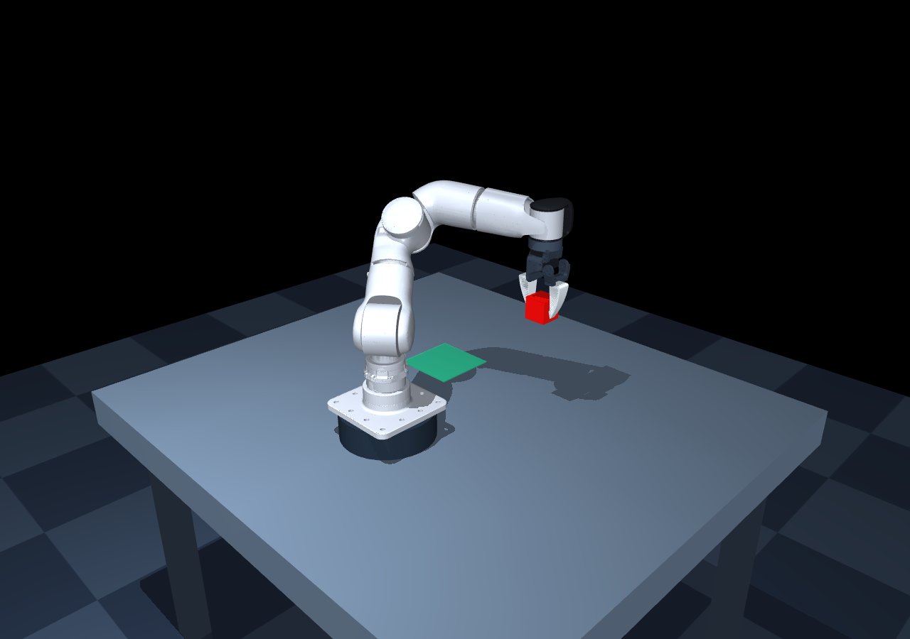

# R1-7A MuJoCo 键盘抓取环境

[English](README.md) | **简体中文**



使用相邻 `r1-7a_sdk` 的原始 URDF、7 个旋转关节、质量/惯性、关节限位及 STL 外观，搭建固定底座机械臂、桌面、红色方块和绿色放置区。末端安装 **XLeRobot / SO101 TPU95A Fin Ray 夹爪**，采用官方 PLA 固定座、活动座和 TPU 手指网格；一侧固定，另一侧由单个旋转关节驱动。

网格保持原始尺寸，仅作毫米转米和刚体坐标变换。R1 法兰转接件、安装位置和 TCP 是本项目的仿真适配，尚未按真实安装标定。

机械臂外观参考 [Unitree R1-ARM 官网产品图](https://www.unitree.com/R1-ARM/)，主体使用略带冷灰的银白色及金属高光，末端接口保留深色。颜色和光泽为根据产品图设置的视觉近似，并非官方色号；SO101 TPU 夹爪维持原有配色。

## 启动

需要 Python 3.10+，图形窗口需要可用的 OpenGL 桌面环境。已在 Linux / Python 3.12 环境验证。

```bash
git clone https://github.com/llros007/unitree_r1-7a-mujoco.git
cd unitree_r1-7a-mujoco
python3 -m venv .venv
source .venv/bin/activate
python -m pip install -r requirements.txt
./run.sh
```

也可在激活的 conda 环境中安装依赖后运行 `python main.py`。设置 `PYTHON=/path/to/python ./run.sh` 可指定解释器。

## 键盘与鼠标

先点击仿真窗口，让窗口获得键盘焦点；按住按键连续移动，松开保持目标位置。移动采用**世界坐标系**，与相机视角无关。

| 按键 | 功能 |
| --- | --- |
| W / S | 末端沿 Y 正 / 负方向移动 |
| A / D | 末端沿 X 负 / 正方向移动 |
| Q / E | 末端上升 / 下降（Z 正 / 负） |
| I / K | 绕世界 X 轴正 / 负旋转 |
| J / L | 绕世界 Y 轴正 / 负旋转 |
| U / O | 绕世界 Z 轴正 / 负旋转 |
| Shift + 移动或旋转 | 慢速微调 |
| Space | 切换夹爪开 / 合 |
| R | 重置机械臂、方块及夹爪 |
| P | 暂停 / 继续 |
| H | 终端打印帮助 |
| Esc | 退出 |
| 鼠标左键拖动 | 旋转相机 |
| 鼠标右键拖动 | 平移相机 |
| 滚轮 | 缩放 |

移动速度 0.10 m/s，Shift 微调速度 0.025 m/s。角速度为 0.75 rad/s，微调为 0.25 rad/s。左上角显示实际 TCP、目标 TCP、方块位置和双侧接触状态。绿色小点是实际 TCP，黄色小球是目标 TCP。

## 抓取步骤

1. 初始末端已朝下，并对准红色方块上方：TCP 约 `(0.12, 0.25, 0.80)` m。
2. 按 E 下降，使目标 TCP 的 Z 接近 **0.626 m**，松开稍等机械臂稳定。桌面 Z 为 0.60 m，方块边长 0.04 m、质量 55 g。
3. 按 Space 合拢夹爪，等待约一秒。界面 `contacts 2/2` 表示两侧指垫都接触方块。
4. 按 Q 抬起；成功夹住并抬离桌面时显示 `CUBE LIFTED!`。
5. 按 A 向负 X 方向搬运至绿色区域，中心约 `(-0.12, 0.25)` m。下降到 TCP 的 Z 约 0.633 m，松开移动键后按 Space 释放。

按键按得过久可能超过可达空间，IK 会限制目标；接近关节限位时换方向或按 R 复位。IK 只求末端位姿，不做障碍物路径规划，绕行和姿态由操作者控制。

## 验证与截图

无界面的物理抓取、搬运、释放验证（失败返回非零退出码）：

```bash
./run.sh --headless --demo
python verify.py
```

`verify.py` 还验证实际键盘处理逻辑中的下降、合拢、抬升、暂停和复位。

生成抓起瞬间的截图：

```bash
./run.sh --headless --demo --snapshot grasp_preview.png
```

只有渲染截图和图形窗口需要 OpenGL；无桌面服务器可用 `MUJOCO_GL=egl` 配合截图命令。纯 `--headless --demo` 不创建图形上下文。

图形窗口冒烟测试：`./run.sh --seconds 3`。

## 文件与建模说明

- `main.py`：GLFW 窗口、键盘持续输入、鼠标相机及状态显示。
- `environment.py`：500 Hz MuJoCo 动力学、100 Hz 控制、位置和姿态的阻尼最小二乘 IK、抓取验证。
- `build_scene.py`：从 SDK URDF 生成场景；可选重建步骤见下文。
- `xle_gripper.py`：SO101 单侧旋转夹爪、开合角度、TCP 和 TPU 接触参数。
- `prepare_gripper.py`：从 XLeRobot 原始 3MF 工程提取夹爪网格；正常运行无需重新提取。
- `assets/gripper/`：官方夹爪网格的坐标转换版本、Apache-2.0 许可证及完整来源记录 `SOURCE.md`。
- `assets/scene.xml`、`assets/meshes/`：已生成场景和复制的原始网格；直接运行不依赖 ROS，也不再依赖相邻 SDK。
- `assets/SDK_LICENSE`：原模型所在 SDK 的许可证；网格来源为相邻 `r1-7a_sdk/urdf/`。
- `grasp_preview.png`：实际仿真中夹起红色方块的截图。

为便于交互，机械臂和夹爪启用了 MuJoCo 重力补偿，关节用受限力的位置伺服驱动。保留机械臂对桌面、地面及方块的碰撞；机械臂自身碰撞关闭，机械臂网格碰撞使用 MuJoCo 凸包。**方块始终是自由刚体，通过接触摩擦抓取，没有焊接约束、吸附或抓起时修改方块位置**。

SO101 夹爪默认打开角度为 0.8 rad，合拢目标为 -0.13 rad，关节范围 [-0.20, 1.05] rad；这些是本仿真安装下的设定，不是实物舵机零点。TCP 在转接后夹爪坐标的 `(0, 0, 0.106)` m，距原 Link7 原点共 0.146 m。

TPU 手指外观保留 Fin Ray 内部肋条，网格本身仍是刚体。抓取面使用分段碰撞代理和软接触（`solref=0.012 1`、摩擦系数 1.8）近似柔顺性，**不包含 TPU 弹性体或肋条弯曲的有限元模拟**。夹爪质量、惯性、摩擦、柔顺性与驱动力矩均未经过实物辨识，不能据此判断真实抓力或形变。

夹爪网格来自 [XLeRobot hardware](https://github.com/Vector-Wangel/XLeRobot/tree/3d14695e40c9c68229c0aacffca6053c75cd3eb6/hardware) 的 `XLeRobot_0_3_0.3mf`，对象 47 为固定座、39 为活动座、49 为 TPU 手指。仓库已有独立的 `SO101_soft_fin.stl` 打印布局；这里从同一 3MF 提取独立部件，避免把打印排版位置当作装配位置。详细转换和来源哈希见 `assets/gripper/SOURCE.md`。

这些设置适用于仿真交互和算法原型，不构成真实 R1-7A 的电机控制标定。启动程序不会打开串口或连接真实机械臂。

MuJoCo API 参考：[Python bindings](https://mujoco.readthedocs.io/en/stable/python.html)、[MJCF XML reference](https://mujoco.readthedocs.io/en/stable/XMLreference.html)。

## 可选：重新生成资产

仓库已包含运行所需的场景和网格，无需下载 SDK 或 XLeRobot。

重新生成机械臂场景时，将 [Unitree SDK](https://github.com/unitreerobotics/r1-7a_sdk) 克隆到本仓库旁的 `../r1-7a_sdk`，再运行 `python build_scene.py`。

重新提取夹爪网格时，准备 `assets/gripper/SOURCE.md` 中指定版本的 XLeRobot，然后运行：

```bash
python prepare_gripper.py --source /path/to/XLeRobot
```

## 许可与来源

本项目代码采用 [BSD-3-Clause](LICENSE) 许可。宇树机械臂网格来自 Unitree SDK，保留其 [BSD-3-Clause 许可](assets/SDK_LICENSE)。XLeRobot 夹爪网格采用 [Apache-2.0](assets/gripper/LICENSE)，具体来源和变换记录见 [SOURCE.md](assets/gripper/SOURCE.md)。本项目为社区仿真项目。
