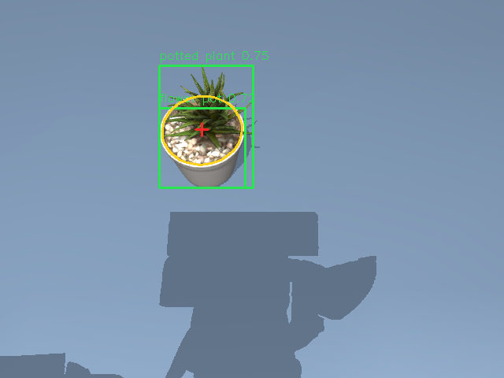
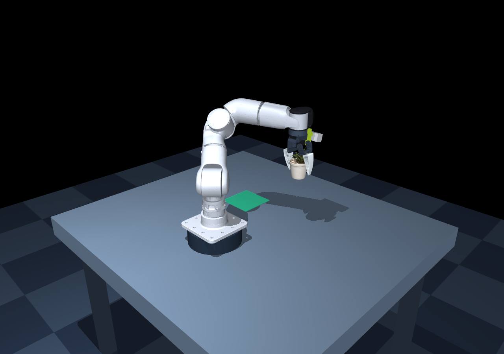
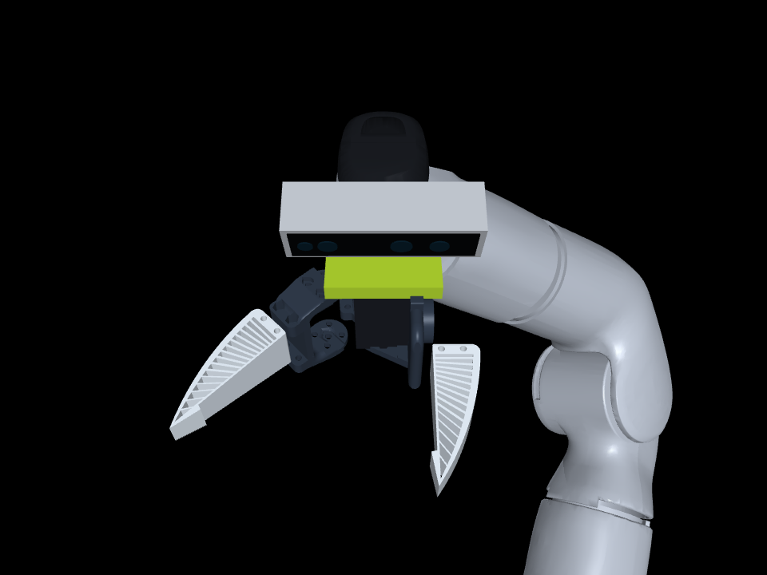

# YOLO RGB-D grasping for R1-7A

**English** | [简体中文](README.zh-CN.md)

Detect a miniature textured [Poly Haven potted plant](https://polyhaven.com/a/potted_plant_04) (CC0) with YOLOE from a **wrist-mounted RealSense D435 approximation**, estimate a top-down grasp from RGB-D, and physically pick and place it with the R1-7A / SO101 TPU gripper. This is an optional extension; the original keyboard viewer still runs separately.





## Run

From the repository root, with the same Python environment used for the original simulation:

```bash
python -m pip install -r yolo_grasp/requirements.txt
./yolo_grasp/run.sh
```

In the simulation window:

| Key | Action |
| --- | --- |
| G | Capture RGB-D, detect the target, then execute one pick/place |
| V | Detect and show the estimated grasp without moving the arm |
| R | Cancel, reset and return the wrist camera to its observation pose |
| P | Pause / resume motion |
| Esc | Exit |

The mouse controls orbit, pan and zoom as in the keyboard viewer. Original manual controls remain available while idle. During an automatic grasp, manual motion and gripper keys are blocked. The bottom-right panels show live wrist RGB and aligned depth (5 Hz); a separate panel shows the last YOLO detection snapshot. Detection is triggered by **G** or **V**, rather than continuously tracked. **R** returns to a fixed observation pose above the workspace, approximately TCP `(0.12, 0.08, 0.83)` m with a 40-degree oblique wrist orientation.

Start automatically or run the complete pipeline without a visible window:

```bash
./yolo_grasp/run.sh --auto
./yolo_grasp/run.sh --headless
./yolo_grasp/run.sh --headless --detect-only
```

`--headless` still renders RGB-D and needs EGL / OpenGL support; this differs from the original physics-only headless demo. CPU inference is the default. Use `--device 0` for a compatible CUDA GPU. The launcher also supports `PYTHON=/path/to/python` and can be called from another directory.

## Models

The default checkpoint is `yolo_grasp/models/yoloe-26s-seg.pt`. The first run downloads it if missing. YOLOE text prompting also downloads a roughly 254 MB MobileCLIP2 text encoder and may install the Ultralytics CLIP tokenizer. Internet access is needed for this initialization. Weights and encoder files are cached in `yolo_grasp/models/`, which is ignored by Git.

You can reuse the reference project's checkpoint:

```bash
./yolo_grasp/run.sh --weights /path/to/reBot-DevArm-Grasp/models/yoloe-26s-seg.pt
```

Replace that path with your actual checkpoint path; `--weights` is resolved relative to the working directory. Weights and text encoders are downloaded separately and are not included in this repository.

Default prompts are `potted plant`, `plant` and `flower pot`, with confidence threshold **0.20**. Zero-shot confidence can change with lighting and image position; no detection causes a stop, without a fallback to object ground truth. To change the target prompts:

```bash
./yolo_grasp/run.sh --classes 'potted plant' 'plant' 'flower pot' --conf 0.20
```

YOLO-World checkpoints are supported, as are ordinary custom YOLO detection/segmentation checkpoints. For a custom model, pass its actual trained class names with `--classes`. Ordinary COCO YOLO models do not include a cube class. Changing class names does not make arbitrary objects physically graspable by this scene.

## Wrist-mounted D435



The layout follows the [TheRobotStudio community D435/D435i wrist mount](https://github.com/TheRobotStudio/SO-ARM100/tree/main/Optional/Wrist_Cam_Mount_RealSense_D435): a horizontal camera bar above the fixed wrist/gripper body, looking toward the grasp area. The community design uses five small wrist screws and two M3×6 camera screws. This simulator uses original simplified bracket geometry adapted to the TPU gripper; it does not redistribute the community STL or establish a printable mechanical fit.

`wrist_mount.py` delegates to the root scene builder, generating `../assets/scene_shared_plant.xml` by default. The keyboard entry uses the same file. Approximate rig parameters in the `hand` frame:

| Parameter | Simulation value |
| --- | --- |
| Camera case | 90 × 25 × 25 mm |
| Case center | `(0, -0.050, 0.018)` m |
| Tilt toward fingers | 15° about local −X |
| RGB optical center in case frame | `(0.035, 0, 0.014)` m |
| Camera + bracket mass | 0.090 kg (approximation) |
| Aligned RGB-D output | 640 × 480 |
| RGB projection | Idealized 4:3 center crop, vertical FOV 42.5° |
| Accepted optical depth | 0.175–3.0 m; invalid values are zero |

The [D400 datasheet](https://realsenseai.com/wp-content/uploads/2024/10/Intel-RealSense-D400-Series-Datasheet-October-2024.pdf) specifies a 175 mm minimum Z for the D435 640×480 depth profile; the 90×25×25 mm housing is from the [manufacturer specifications](https://www.intel.com/content/www/us/en/products/sku/128255/intel-realsense-depth-camera-d435/specifications.html). The optical intrinsics, pose, tilt and bracket dimensions here are simulation approximations, not factory or hand-eye calibration. Real D435 depth/RGB have separate intrinsics and extrinsics; this demo renders ideal depth already aligned to a cropped RGB projection. It does not simulate stereo matching, distortion, projector patterns, noise or USB streaming.

Capture takes place at the observation pose, above the near depth limit. The grasp pose is then frozen in world coordinates. During descent, close objects may show black/invalid depth; the controller continues the already estimated grasp rather than requiring close-range depth. The live sensor moves with the hand; rotating the external viewer does not move it. Workspace limits are acceptance bounds, not a guarantee that the whole table is visible from one wrist pose.

For pose/calibration details and community references see [CAMERA_SOURCE.md](CAMERA_SOURCE.md).

## Perception and motion

1. A D435 approximation is fixed to the SO101 wrist and captures aligned RGB and optical-axis depth in meters. Intrinsics come from its RGB profile; extrinsics are recomputed from the current wrist/camera pose for every capture. OpenGL camera axes are converted to the OpenCV camera convention (right/down/forward).
2. YOLOE predicts target boxes and segmentation masks from the RGB image. Detection-only models use their bounding-box regions instead of masks.
3. Valid depth pixels inside an eroded mask are backprojected to the world frame. The calibrated table plane is Z = 0.60 m. Only object surface points with Z in `(0.608, 0.70)` m are retained.
4. For the plant, brown pot pixels and the calibrated height range isolate the pot. A circle fitted to upper-rim depth points estimates center and diameter despite the oblique view; yaw stays fixed for this round pot. TCP Z is the estimated rim minus insertion (default 0.014 m), clamped above Z=0.622 m. Cube mode retains the minimum-area rectangle and short-axis method.
5. The existing Cartesian IK and force-limited servos execute align → pregrasp → descend → close → lift → transfer → place → release → retreat. Intermediate targets are interpolated. Pose tracking, bilateral finger contact and placement success are checked.

Target coordinates come from the images/depth, not `cube_position`, segmentation IDs, or a hard-coded cube XY position. Object state and contact IDs are used only for physical success checks. The target remains a free body; there are no attachment constraints or object position edits in the grasp pipeline. The verification script changes initial target poses only to arrange test scenes.

The pick workspace is X `[-0.22, 0.24]`, Y `[0.12, 0.38]` m. Accepted short-edge widths are 0.015–0.065 m; maximum long-edge length is 0.12 m. Unreachable poses, absent detections, invalid depth and failed contact stop the sequence. On failure the arm holds its current command; **R** resets it. This is not a collision-aware motion planner or a hardware safety controller.

The current motion/placement heights and success checks are verified for the miniature plant and original 4 cm cube. The pot uses convex mesh collision; leaves and soil are visual only, without leaf deformation or damage. See [asset provenance](assets/plant04/SOURCE.md). This is a top-down, static tabletop demo. It does not model arbitrary 6D grasps, moving targets, piles, full TPU elasticity, or real-camera calibration. GraspNet and real robot/camera drivers are not imported or required.

## Speed and target

Default `--speed 0.5` doubles motion durations. Jaw speed stays at the shared 0.30 rad/s setting, and open/close waits always cover its travel. A full sequence takes about 44 simulation seconds. Use `--speed 0.3` to slow it further, or `--object cube` to return to the cube. Allowed speed range: 0.1–1.0. Restart after changing the assets or options.


## Shared control and physics

This entry and keyboard teleoperation use the same root `environment.py`, `wrist_scene.py`, `motion.py`, `motor_config.json` and `end_effector.json`. They share the plant scene, home/reset pose, collisions, masses, jaw speed, PD gains, gravity feedforward and SDK command quantization.

Defaults are `kp=60`, `kd=[6,6,4,4,2,2,1.5]`, 100 Hz host commands and 500 Hz simulation PD. The earlier separate high-gain defaults have been removed. This directory's `motor_config.json` is a compatibility symlink to the root configuration. `wrist_mount.py` and `controller.py` delegate to the shared implementations. Perception supplies target poses without overriding motor/physics settings.

Both entries accept `--motor-config`, `--end-effector-config` and `--record /new/path/trace.csv`. See [shared control](../SHARED_CONTROL.zh-CN.md).

## Outputs and verification

Each run writes to `yolo_grasp/outputs/latest/` by default. Use `--output /path/to/run` to keep separate runs.

| File | Contents |
| --- | --- |
| `rgb.png` | Input RGB frame |
| `detection.png` | Boxes, fitted rectangle and grasp center |
| `rgbd.npz` | Metric depth, intrinsic matrix `K`, `world_from_camera` transform |
| `grasp.json` | Perceived class, confidence, world TCP pose and estimated width |
| `lift.png`, `placed.png` | Physical lift and final placement screenshots |
| `result.json` | Success/contact/placement checks or a stop reason |

Run the integration check:

```bash
python yolo_grasp/verify.py --conf 0.15
```

The three-position check uses `--conf 0.15`; one valid detection is around 0.18, below the unchanged application default of 0.20. It uses the actual YOLO model, RGB-D rendering and contact dynamics at three target positions. It also checks that wrist motion changes the camera world pose while preserving the hand-to-camera transform, applies the D435 near cutoff, and rejects absent detections, invalid depth and a grasp that misses the object. Results are saved in `yolo_grasp/outputs/verification/verification.json`. A failed check exits nonzero. The original regression is still available with `python verify.py`.

On a desktop, `python yolo_grasp/verify.py --gui` additionally checks the real viewer, detection inset, G/V/R/P callbacks, full grasp with screenshots, reset and window cleanup. Use the GLFW backend for this check (`MUJOCO_GL=glfw`) if your shell has another backend exported.

## Files and reference

- `camera.py`: wrist RGB-D rendering, current optical pose and backprojection.
- `wrist_mount.py`: separate scene builder with D435 housing, bracket and camera.
- `detector.py`: YOLOE / YOLO-World / custom YOLO loading and detection parsing.
- `planner.py`: mask/depth validation and top-down grasp estimation.
- `controller.py`: nonblocking pick/place state machine.
- `motor_config.json`: optional torque-controller gains for this extension.
- `main.py`: command-line runner and GLFW viewer with a detection inset.
- `verify.py`: end-to-end integration checks and failure cases.

The design follows the ordinary-grasp workflow in [reBot-DevArm-Grasp](https://github.com/EclipseaHime017/reBot-DevArm-Grasp), especially `utils/yolo_utils.py`, `utils/ordinary_grasp.py` and `scripts/ordinary_grasp_pipeline.py`. The R1 camera, TCP orientation and MuJoCo execution are implemented here for this simulator; reBot hardware drivers/calibration are not reused.

YOLO/YOLOE is an external Ultralytics dependency with its own [license terms](https://docs.ultralytics.com/help/FAQ/#ultralytics-license). Third-party model weights are not redistributed in this repository. API references: [YOLOE](https://docs.ultralytics.com/models/yoloe/) and [MuJoCo Python](https://mujoco.readthedocs.io/en/stable/python.html).

## Random placement and wrist search

Run `./yolo_grasp/run.sh --auto --randomize --seed 42` (or `--headless`).
Placement uses x=0.10..0.18 m, y=0.25..0.31 m and random yaw. G visits up to
six overlapping wrist views, detects a target, holds until measured motion
settles, and captures fresh RGB-D/extrinsics before planning a grasp. Failed
localization advances to the next view; exhausted search fails without grasping.
Search events and separate capture times are recorded in `result.json`.
Run `python yolo_grasp/verify.py` for contact/perception trials and
`python yolo_grasp/verify_search.py` for empty-search/pause/cancel checks.

## Licensing

This optional Ultralytics integration is distributed under [AGPL-3.0-or-later](LICENSE), including the combined YOLO application. The standalone simulator core retains BSD-3-Clause. Downloaded weights and dependencies keep their upstream licenses. See [third-party notices](../THIRD_PARTY_LICENSES.md).
